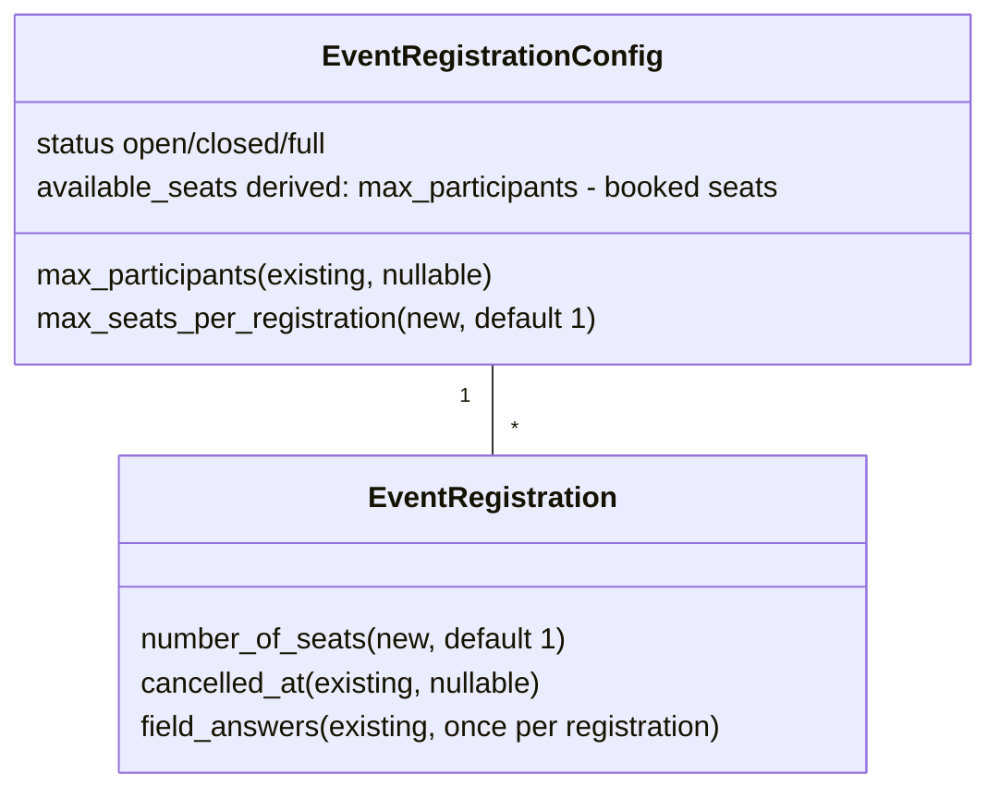
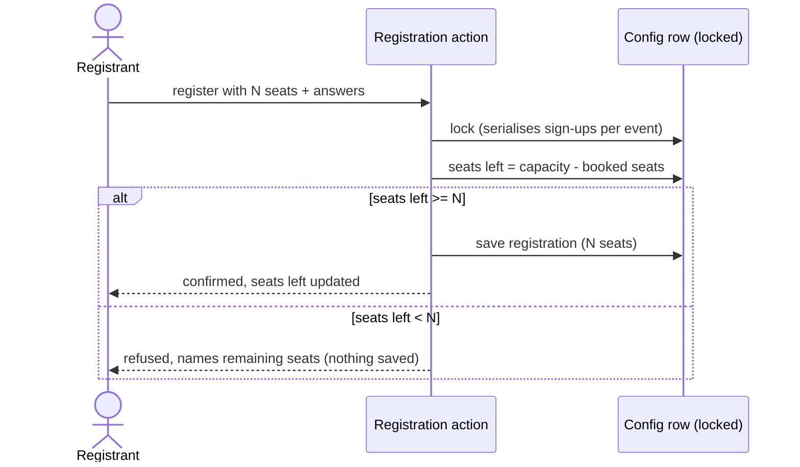

# Event registration: bring guests (multiple seats per registration)

**Status**: IMPLEMENTATION — spec, system impact and docs approved 2026-10-21; handed to implementation
**Type**: Full stack — feature
**Date created**: 2026-10-21
**Source requirement**: [doc/requirements/event-registration-guest-seats.md](../requirements/event-registration-guest-seats.md) — "Bring guests to an event (multiple seats per registration)", Ready for spec, 2026-10-19
**GitHub Issue**: [#2348](https://github.com/climateconnect/climatehub/issues/2348) (its title predates the vocabulary decisions below; its count-word is cosmetic)

**Depends on** (code this feature touches):
- [backend/organization/models/event_registration.py](../../backend/organization/models/event_registration.py) — `EventRegistrationConfig`, `EventRegistration`
- [backend/organization/utility/event_registration.py](../../backend/organization/utility/event_registration.py) — `evaluate_registration_status` (FULL/OPEN evaluation)
- [backend/organization/views/event_registration_views.py](../../backend/organization/views/event_registration_views.py) — registration POST/DELETE, config PATCH, admin cancel
- [backend/organization/serializers/event_registration.py](../../backend/organization/serializers/event_registration.py) — config serializers, `EventRegistrationSerializer`, `EventRegistrationSubmissionSerializer`
- [backend/organization/tasks.py](../../backend/organization/tasks.py) and [backend/organization/utility/email.py](../../backend/organization/utility/email.py) — confirmation + organiser notification emails
- [frontend/src/components/project/EventRegistrationModal.tsx](../../frontend/src/components/project/EventRegistrationModal.tsx) — registration dialog
- [frontend/src/components/project/EditEventRegistrationModal.tsx](../../frontend/src/components/project/EditEventRegistrationModal.tsx) — organiser registration settings dialog (edit surface)
- [frontend/src/components/shareProject/EventRegistrationSection.tsx](../../frontend/src/components/shareProject/EventRegistrationSection.tsx) — organiser registration settings in the create/edit event flow
- [frontend/src/components/project/ProjectRegistrationsContent.tsx](../../frontend/src/components/project/ProjectRegistrationsContent.tsx) — organiser attendee list, footer totals, CSV export
- [frontend/src/components/project/ProjectPageRoot.tsx](../../frontend/src/components/project/ProjectPageRoot.tsx) — seats-left state and optimistic seat updates
- [frontend/public/texts/project_texts.tsx](../../frontend/public/texts/project_texts.tsx) — UI copy (EN/DE; existing `seats_available` = "Seats available" / "Verfügbare Plätze")
- Docs (already updated 2026-10-21 to the post-implementation state — keep in sync): [doc/api-documentation.md](../api-documentation.md), [doc/mosy/entities/system-entities.md](../mosy/entities/system-entities.md), [doc/mosy/flows/core-flows.md](../mosy/flows/core-flows.md)

---

## Problem Statement

Every event registration books exactly one seat today. A member who wants to bring a partner, a child or friends has no way to reserve seats for them — each guest would need their own account, or the organiser guesses the headcount. Organisers then don't know how many people are really coming, which matters for venue limits and catering. With this feature an organiser can allow up to N seats per registration; a registrant books 1..N seats in one step (themselves plus guests), and all seats count toward `max_participants`. No guest data is collected — one registration plus a number of seats (Luma-style).

**Vocabulary (stakeholder decisions 2026-10-21)**: the bookable quantity is a **seat** — one word only (EN "seat(s)", DE "Platz/Plätze"); the brief's synonym for it is dropped everywhere: spec, code, UI, docs. The existing terms (`max_participants`, `available_seats`, "Seats available" / "Verfügbare Plätze") already say what we mean — the German "Verfügbare Plätze" beside the registration button stays exactly right with this change, as it then counts every booked seat including guests. The only change is that a registration books 1..N seats instead of implicitly 1, and that count is stored. The two organiser settings keep people-word labels per language: the total is unchanged ("Max. number of guests" / "Max. Anzahl Teilnehmende"), and the new per-registration maximum is "Max. seats per registration" (EN — deliberately not "guests", which people read as *additional* to themselves and would set the wrong cap) / "Max. Anzahl Teilnehmende pro Anmeldung" (DE — stakeholder wording; "Teilnehmende" is unambiguous in German).

## Key findings from the code

1. **Capacity is computed independently in several sites.** Today each counts active *registrations*. Confirmed sites: `evaluate_registration_status` in `utility/event_registration.py`; `_compute_available_seats` and the post-create count in the registration POST handler (`views/event_registration_views.py`); `get_available_seats` in `EventRegistrationConfigBaseSerializer`; and the `max_participants` lower-bound / fully-booked guards in `EditEventRegistrationConfigSerializer.validate`. All must switch to summing seats at once — a partial switch makes the numbers inconsistent (hand-off notes).
2. **Locking already serialises sign-ups per event.** The registration POST runs inside `@transaction.atomic` and takes `select_for_update` on the `EventRegistrationConfig` row before the capacity check. A multi-seat check-and-create under that same lock stays race-free without new mechanisms.
3. **Contract today**: POST `/api/projects/{slug}/registrations/` accepts optional `answers[]` and answers with `{registered, available_seats}`. The organiser GET returns rows with `id`, name fields, `registered_at`, `cancelled_at`, `cancellation_reason`, `field_answers`. `available_seats` is also embedded in `registration_config` on project endpoints (detail only).
4. **Soft-delete lifecycle.** Cancelling sets `cancelled_at`/`cancelled_by` on the row; the row persists and re-registration re-uses it (resetting the cancel fields and replacing all custom-field answers via `sync_registration_answers`). The number of seats must follow the same pattern: kept on cancelled rows, replaced on re-registration.
5. **Config PATCH guards are registration-count based.** Lowering `max_participants` below the current registration count is rejected, and reopening while at capacity is rejected. Both become seat-sum based.
6. **Frontend optimistic seat arithmetic assumes 1 seat.** `ProjectPageRoot` (+1 on register, −1 on cancel) and `ProjectRegistrationsContent` (+1 on admin cancel) adjust `available_seats` by one.
7. **Email copy lives in `organization/utility/email.py`** (`send_event_registration_confirmation_to_user`, `send_admin_event_notification`) with per-language subject/body dicts — that is where the seat-count wording goes. Bulk guest email stays one email per registration.
8. **Texts have no plural machinery** — flat `{en, de}` dicts. Singular/plural ("1 seat / 2 seats", "1 Platz / 2 Plätze") needs separate keys selected on the count, in the UI and in the email strings.
9. **`available_seats` needs no rename.** Its name already matches the vocabulary; only its semantics change from "registrations left" to "seats left" (sum of per-registration seats).

## Design decisions

| Question | Decision | Rationale |
|---|---|---|
| Vocabulary | One word for the bookable quantity: "seat" (EN) / "Platz" (DE), used in spec, code, UI and docs; the brief's synonym is dropped | Stakeholder 2026-10-21: existing domain terms already match how seats are treated; two words for one thing are just confusing |
| Setting labels | Total (existing, unchanged): "Max. number of guests" / "Max. Anzahl Teilnehmende". New per-registration maximum: EN "Max. seats per registration", DE "Max. Anzahl Teilnehmende pro Anmeldung" (stakeholder wording; full form "Maximale Anzahl Teilnehmende pro Anmeldung") | Stakeholder 2026-10-21: EN "guest" is ambiguous here (read as *additional* people → wrong cap values); DE "Teilnehmende" is unambiguous. EN uses "seats" to match the dialog question and the unit actually booked |
| Organiser setting | New per-event setting on `EventRegistrationConfig`: maximum seats per registration (`max_seats_per_registration`), default 1, minimum 1, no platform-wide cap | Brief M1/D3/D12. Default 1 means existing and new events behave exactly as today until an organiser opts in |
| Seats on the registration | New field on `EventRegistration` (`number_of_seats`), default 1 | Stakeholder 2026-10-21: "a registration can book 1..N seats and we need to store it (currently a registration = 1 seat)". A DB default of 1 backfills existing rows with exactly one seat each, no data migration |
| One seat calculation | One shared "booked seats" calculation (sum of `number_of_seats` over active registrations) used by every capacity site | Hand-off notes: all sites must give the same result |
| API contract | POST accepts optional `number_of_seats` (integer ≥ 1); absent → 1. Attendee-list rows and config serializers expose the new fields | Backward compatible for clients (incl. codegen) that send no seat count |
| Race freedom | Keep the existing per-event `EventRegistrationConfig` row lock as the single serialisation point; check requested seats against remaining seats inside it | Today's locking already guarantees this for single seats; no new mechanism needed |
| Over-capacity refusal | 400 with a message naming how many seats are left; nothing is saved (atomic request, no partial writes) | Brief M4/D16 |
| Feature toggle | **None.** With default 1 the feature is inert per event; a toggle would add rollout/teardown work without reducing risk | D14 delegates this to spec writer + architect. The existing `EVENT_REGISTRATION` toggle can't be reused (feature is live). Architect confirmed in System impact (2026-10-21): no toggle |
| Editing seat count later | Cancel and register again; cancel frees all seats | Brief M6/D9. Adding registration editing would grow scope a lot |
| Settings in both organiser surfaces | The setting appears wherever `max_participants` is edited today: the create/edit event registration section and the edit-registration-settings dialog. On the edit surface it follows the same logic as the other configuration fields | Stakeholder 2026-10-21: both surfaces, so existing events can opt in at any time |
| Inventory fields | Not relevant to this feature — no organiser hint and no interaction beyond the unchanged semantics (answers once per registration, `max_amount_per_guest` per registration) | Stakeholder 2026-10-21: single-option inventory fields are a useful independent feature (issue #2322), not a headcount workaround |
| Adoption measurement | **No analytics events.** Usage and adoption are read from the database | Stakeholder 2026-10-21: event and registration data suffice — former C1 (Google Analytics tracking) dropped from scope |
| Event page | No mention of guests on the event page | Brief D13 — the page is already overloaded |
| Time slots / inventory | Unchanged: a time slot is taken once per registration; inventory `max_amount_per_guest` stays a limit per registration | Brief M6/M7/D7/D10 |

## Acceptance Criteria

### Organiser setting

- [ ] **AC-1 (M1)**: Organisers can set a maximum number of seats per registration per event — labelled "Max. seats per registration" (EN) / "Max. Anzahl Teilnehmende pro Anmeldung" (DE) — (default 1 = one seat per registration, exactly today's behaviour; minimum 1). There is no platform-wide cap beyond `max_participants`. The setting is available in both organiser settings surfaces and behaves there like the other registration-config fields (optional, validated against stored values, not required at publish).
- [ ] **AC-2 (M1)**: The setting can be changed later. Existing registrations keep their number of seats even if the setting is lowered below them; new registrations use the current setting.

### Registrant flow

- [ ] **AC-3 (M2)**: When the maximum is above 1, the registration dialog asks "How many seats?" (EN) / "Wie viele Plätze?" (DE) (default 1 = only the registrant). The form only offers as many seats as are actually available: the lower of the organiser's maximum per registration and the seats left (for unlimited-capacity events: the organiser's maximum). When the maximum is 1, the question is not shown at all.
- [ ] **AC-4 (M3)**: All seats count toward `max_participants` everywhere: the "x / y" seats-left display on the event page, the FULL status, re-opening after a cancellation, and the guard when an organiser lowers capacity. There is no option to exclude guests from capacity.
- [ ] **AC-5 (M4)**: A registration can never exceed the remaining seats. If seats run out between opening the form and submitting, the submission is refused with a clear message saying how many seats are left, and nothing is saved. Simultaneous sign-ups never overbook — booked seats never exceed `max_participants`.
- [ ] **AC-6 (M5)**: No guest names, emails or other guest data are collected. A registration is one row plus a number of seats.
- [ ] **AC-7 (M6)**: Custom-field answers stay once per registration. Inventory `max_amount_per_guest` stays a limit per registration. No field is linked to the seat count.
- [ ] **AC-8 (M7)**: A time slot is taken once per registration, whatever the number of seats.

### Organiser surfaces, emails

- [ ] **AC-9 (M8)**: The number of seats is shown in the organiser attendee list, the CSV export, the registrant confirmation email and the organiser notification email (with correct singular/plural). The total number of seats booked (active registrations) is visible to the organiser.
- [ ] **AC-10 (M12)**: Cancelled registrations keep showing their former number of seats in the attendee list and CSV, and do not count toward capacity.

### Cancellation and changes

- [ ] **AC-11 (M9)**: Changing the number of seats is only possible by cancelling and registering again. Cancelling (by the registrant or the organiser) frees all seats of that registration.

### Compatibility

- [ ] **AC-12 (M11)**: Existing events and registrations behave exactly as today (each existing registration = 1 seat; events without the setting allow no guests).
- [ ] **AC-13 (hand-off)**: The API contract stays backward compatible: clients that send no seat count keep working and book exactly one seat.

### i18n

- [ ] **AC-14 (M10)**: All new text exists in English and German, including singular and plural forms ("1 seat / 2 seats", "1 Platz / 2 Plätze") — UI copy and both emails.

### Tests

- [ ] **AC-15**: Automated tests cover multi-seat capacity accounting (seats left, FULL/OPEN transitions, refusal with remaining-seats message, no overbooking under concurrency), cancellation freeing all seats, re-registration replacing the seat count, the seats-based `max_participants` lower-bound guard, backward-compatible submissions without a seat count, and the new fields in the attendee-list and config contracts. Frontend tests cover the seat-count selector and its capping.

## Constraints

- **Privacy (brief §8)**: no data about guests. The registrant is the only contact; emails go to the registrant only.
- **Reuse**: keep it small — reuse the existing registration dialog, settings screens and email templates. No new screens.
- **Contract**: registration endpoints are consumed by the frontend and possibly OpenAPI codegen; additive changes only (`doc/api-documentation.md` must be updated).
- **Unchanged capacity semantics**: time-slot and inventory capacity counting stays per registration / per quantity.
- **No analytics work**: adoption metrics come from the database (see Design decisions); do not touch the GA funnel.
- **Verification**: backend tests via `pdm run python manage.py test organization --keepdb` (PostgreSQL + Redis running); frontend via `yarn test`, `yarn lint`, `yarn check-types` — TypeScript compile must be included (`frontend.verification.include_compile`). `make format` before committing. Bug fixes during implementation follow the test-first rule (`workflow.bug_fix.test_driven`).
- **No `window.alert`** for new error handling — MUI error display patterns (`frontend.error_handling.no_window_alert`).

## Technical scope

### Data model

- `EventRegistrationConfig`: new positive-integer organiser setting `max_seats_per_registration`, default 1 (minimum 1, no platform cap).
- `EventRegistration`: new positive-integer `number_of_seats`, default 1.
- Field names use "seats" throughout the backend/API — stakeholder-confirmed 2026-10-21 (`number_of_seats`, `max_seats_per_registration`, `available_seats`), matching German "Plätze".
- Both NOT NULL with DB default 1. **Existing data is handled by the schema migration itself**: adding the columns with default 1 writes 1 into every existing row during `migrate` — all registrations (active and cancelled) and all existing registration configs. No data migration, no backfill script. Consequences: every existing registration counts as exactly 1 seat (M11/D17), existing events allow no guests until an organiser raises the setting (AC-12), and because every existing row holds 1, the redefined `available_seats` yields exactly the same numbers as today on day one. The migration must add the columns *with* the default — adding them nullable or without default would need a separate backfill.
- `RegistrationField*` and all answer models: unchanged.

### Capacity rule (single source of truth)

- Booked seats = sum of `number_of_seats` over active (non-cancelled) registrations of the config. Seats left (`available_seats`) = `max_participants` − booked seats (`None` for unlimited capacity).
- Every site listed in finding 1 must use this one calculation: FULL/OPEN evaluation, both view-side seat computations, `available_seats` in the base serializer, and the `max_participants` lower-bound / fully-booked guards in the config PATCH serializer. Status transition behaviour is unchanged; only the arithmetic switches from counting registrations to summing seats.
- The frontend optimistic `available_seats` adjustments (register/cancel/admin-cancel) use the registration's `number_of_seats` instead of ±1.

### API contract (additive)

- `POST /api/projects/{slug}/registrations/`: optional `number_of_seats` (integer ≥ 1). Absent or 1 = today's behaviour. Server validates: within the organiser's per-registration maximum, and ≤ seats left at submit time (inside the existing lock). Over capacity → 400 with a message naming how many seats are left; nothing saved. Validation order stays: capacity gate before creating/re-activating the row.
- Attendee-list rows (`GET .../registrations/`): add `number_of_seats`, present on cancelled rows too.
- `registration_config` on project endpoints and `PATCH .../registration-config/`: add `max_seats_per_registration` (writable where `max_participants` is writable; optional; default 1). On the edit surface it is handled like the other configuration fields — partial update, validation merged with stored values, never required at publish.
- `available_seats` keeps its name (it already says the right thing); its value becomes seats left. The POST response's `available_seats` likewise.

### Emails

- Confirmation email and organiser notification email show the number of seats (singular/plural, EN/DE). Bulk guest email: unchanged, one email per registration.

### UI

- **Organiser settings** (both surfaces): numeric input labelled "Max. seats per registration" (EN) / "Max. Anzahl Teilnehmende pro Anmeldung" (DE) (default 1). Existing events can opt in at any time through either surface. The total keeps its current label ("Max. number of guests" / "Max. Anzahl Teilnehmende").
- **Registrant dialog**: "How many seats?" / "Wie viele Plätze?" selector per AC-3; capacity refusal message per AC-5; default 1. The capacity line beside the register button ("Seats available" / "Verfügbare Plätze") is unchanged and now counts every booked seat.
- **Attendee list**: seats column for active and cancelled rows; total booked seats visible to the organiser (footer); `number_of_seats` included in CSV export fields (and the print field list for consistency).

### Docs

- `doc/api-documentation.md` *(applied 2026-10-21)*: new fields on POST payload, attendee rows, `registration_config`; updated `available_seats` wording ("seats left").
- `doc/mosy/entities/system-entities.md` *(applied 2026-10-21)*: new properties on `EventRegistrationConfig` and `EventRegistration`.
- `doc/mosy/flows/core-flows.md` *(applied 2026-10-21)*: flow 5 settings note; new flows 7 (register with seats) and 8 (cancellation frees all seats).

## Out of scope (brief §9)

- Editing the number of seats on an existing registration (registrant or organiser) — cancel + re-register only.
- Guest names, emails or per-guest answers.
- Linking food/inventory amounts to seats; per-person food limits.
- Allergies/diet handling (future multiselect field type, separate topic).
- Counting time slots per person (watch-out listed in risks).
- Waitlist (does not exist today).
- Any change to single-option inventory fields (issue #2322) — they remain a useful independent feature for other use cases and are not part of this feature.
- An organiser option to exclude guests from capacity.
- Mentioning guests on the event page (D13).
- A platform-wide cap on seats per registration (D12).
- Google Analytics tracking of the seats chosen per registration (former C1) — dropped; adoption and usage are read from the database (stakeholder 2026-10-21).

## Directional hints (suggestions, not requirements)

- The existing `select_for_update` lock on the `EventRegistrationConfig` row in the registration POST is the natural single serialisation point: compute remaining seats and create/re-activate the row under it, as today. No denormalised counter is needed.
- Texts: pick singular vs plural copy by the count (e.g. two keys per phrase). There is no plural-form library in the texts system, and the emails build per-language strings the same way.
- `EditEventRegistrationModal` currently derives a participant count from `max_participants − available_seats`; once seats are summed, that display naturally becomes the headcount organisers want (M8) — no separate total is needed beyond the attendee-list footer.
- Keep inventory/time-slot capacity code untouched except where it reads registration rows for its own per-registration counting.
- Adoption queries (brief §7) are plain reads over `EventRegistration.number_of_seats` and `EventRegistrationConfig.max_seats_per_registration` — no instrumentation.
- Optional polish (not required for v1): the settings form would read more symmetrically if the existing total label ("Max. number of guests") were ever aligned with the German "Teilnehmende" family. Out of scope here.

## Tests

**Backend** (extend the existing `backend/organization/tests/test_event_registration_*.py` suites; `pdm run python manage.py test organization --keepdb`):
- Backward compatibility: POST without `number_of_seats` books one seat; seats left drops by 1; idempotent re-POST unchanged.
- Multi-seat booking: seats left drops by N; FULL when booked seats reach `max_participants`; reopening after cancelling a multi-seat registration frees N seats.
- Over-capacity refusal: requesting more seats than left → 400 naming the remaining seats, nothing saved (no row, no answers); requesting within the per-registration maximum but beyond seats left likewise refused.
- Concurrency: two multi-seat sign-ups that together exceed capacity — exactly one succeeds (lock serialisation); booked seats never exceed `max_participants`.
- Per-registration maximum enforced server-side even if the client sends a larger number.
- Re-registration after self-cancel replaces the seat count; cancelled rows retain theirs (attendee list) and never count toward capacity.
- Config PATCH: lowering `max_participants` below booked seats is rejected with a seats-based message; FULL→OPEN guards use seats; `max_seats_per_registration` round-trips, stays ≥ 1, and follows the partial-update rules of the other config fields.
- Attendee list rows include `number_of_seats` for active and cancelled registrations.
- Emails include the seat-count wording (both languages, singular and plural).
- Existing suites (`test_event_registration_sold_out`, `test_event_registration_cancel`, `test_event_registration_config`, `test_event_registration_admin_cancel`, …) stay green unchanged.

**Frontend** (jest, `yarn test`; then `yarn check-types`, `yarn lint`):
- Seat-count selector hidden when the maximum is 1; shown above 1; default 1; capped at min(maximum, seats left); payload carries `number_of_seats`.
- Settings surfaces: the new input validates ≥ 1 and submits (both surfaces); edit surface preserves unsent fields like the other config fields.
- Attendee list + CSV: seats column present; footer total counts seats of active rows only.
- Plural copy selection for 1 vs 2+ seats.

**Manual**: organiser enables 2 seats on a small event (through the settings dialog and through the edit-event flow); two members book 3 and 2 seats; seats-left display and FULL status match headcount; organiser CSV/list/emails show seat counts; cancel the 3-seat booking → 3 seats return; re-register with 2; lower `max_participants` below booked seats → rejected; a fresh client without the new payload field registers normally.

## Resolved questions

All product decisions D1–D17 are settled in the requirements brief (2026-10-19) and are treated as inputs, not re-litigated here. User review 2026-10-21 resolved the spec-level items:

1. **Vocabulary**: one word for the bookable quantity — "seat" (EN) / "Platz" (DE) — in spec, code, UI and docs; the brief's synonym is dropped (the issue #2348 title predates this; cosmetic). A registration books 1..N seats and the count is stored. Copy scheme: capacity display "Seats available" / "Verfügbare Plätze" unchanged and now counts guest seats too; dialog "How many seats?" / "Wie viele Plätze?"; new setting "Max. seats per registration" / "Max. Anzahl Teilnehmende pro Anmeldung" (DE wording from the stakeholder; EN deliberately avoids "guest", which reads as *additional* people). "Guest(s)" stays only in existing copy where it means the registered person (e.g. "Max. number of guests", attendee-list strings).
2. **Adoption analytics (former C1)**: dropped from scope — no Google Analytics tracking; usage is derived from the database (event + registration data). This supersedes the hand-off note about the analytics funnel in the requirements brief, §12. The success criteria in brief §7 are answered with DB queries over `number_of_seats` / `max_seats_per_registration`.
3. **Settings surfaces**: both confirmed — the create/edit event flow and the edit-registration-settings dialog, so existing events can opt in at any time. On the edit surface the new field applies the same logic as the other configuration fields.
4. **GitHub issue**: created as [#2348](https://github.com/climateconnect/climatehub/issues/2348) and linked in the header.
5. **Feature toggle (D14)**: none — default 1 makes the feature inert per event. Architect confirmed this in System impact (2026-10-21).
6. **Inventory hint (risk §10)**: not needed — inventory fields are a useful independent feature for other single-option use cases (issue #2322), not a headcount workaround; this feature interacts with them only through the unchanged M6 semantics. The brief's "workaround" framing is not adopted.
7. **Public "seats left" figure** counts seats (assumption in brief §10 confirmed: implied by D4/D8 and M3).
8. **Field naming** (`max_seats_per_registration`, `number_of_seats`, `available_seats`): stakeholder-confirmed 2026-10-21 — the backend/API keeps "seats", matching German "Plätze".

## AI Agent Insights and Additions

### Confirmed against current code

- The four backend seat-counting sites named in the hand-off notes exist exactly where stated (`utility/event_registration.py` evaluate; `views/event_registration_views.py` `_compute_available_seats` + POST step 8; `serializers/event_registration.py` base `get_available_seats`; `EditEventRegistrationConfigSerializer.validate` lower-bound + fully-booked guards). Plus two frontend optimistic counters (`ProjectPageRoot`, `ProjectRegistrationsContent`) that also assume 1 seat per registration.
- The registration POST is `@transaction.atomic` and locks the `EventRegistrationConfig` row with `select_for_update` before any capacity check, so multi-seat booking is race-free under the current locking model — the hand-off requirement "capacity must stay race-free when one request takes several seats" is satisfied by keeping that lock as the serialisation point.
- Re-registration re-uses the existing row and `sync_registration_answers` replaces answers; `number_of_seats` must therefore be written both on create and on re-activation. The idempotent "already registered" 200 path must not alter the seat count.
- `max_participants` is nullable (unlimited) and `available_seats` returns `null` in that case — the selector cap for unlimited events is the per-registration maximum alone.
- Email copy (subject/body per language) for both the confirmation and the admin notification is composed in `utility/email.py`; no template engine changes are needed to add a seat-count line.
- Existing vocabulary in texts confirms the EN/DE pair: `seats_available` = "Seats available" / "Verfügbare Plätze" — new copy follows the same terms.

### Watchouts found while reading the code

- Do not switch only part of the capacity sites — finding 1's list is the complete inventory; grep for `.count()` on active registrations against `registration_config` during implementation to catch stragglers (e.g. any new code added since this spec).
- Frontend `+1 / −1` optimistic seat updates silently under-count with multi-seat bookings until they use the registration's `number_of_seats`.
- `_are_required_fields_sold_out` and the inventory/time-slot per-option checks count *answers*, not seats — do not multiply them by the seat count (M6/M7).
- The over-capacity refusal must run before `EventRegistration.objects.create` / re-activation inside the same transaction so nothing is saved (AC-5). The refusal text names the remaining seats, so the count is read under the lock.
- `EventRegistrationSubmissionSerializer` validates answers only; the seat-count check belongs at the registration boundary (view or a small serializer extension) so answers validation is not disturbed.
- Cancelled rows keep their `number_of_seats` for display (M12) — do not reset the field on cancel; capacity sums filter on `cancelled_at__isnull=True` as today.
- Texts are flat `{en, de}` dicts — implement plural phrasing with explicit singular/plural keys rather than expecting i18n plural machinery.
- Do not rename `available_seats` or `max_participants` — the vocabulary decision means no renaming exercise; only semantics of `available_seats` shift to seat sums.

## System impact

*(Archie, 2026-10-21 — assessment against `doc/mosy/`.)*

### Summary

Small, contained change, matching the expected size (brief D17). One new organiser setting, one new per-registration count, and one derived quantity redefined (seats left = capacity − booked seats). No new actors, no new flows, no new events, no new integration points, no feature toggle. Everything attaches to the existing event-registration subsystem; the rest of the platform is untouched.

### Actors affected

| Actor | Impact |
|---|---|
| Member (registrant) | Registers with 1..N seats in one step; custom answers stay once per registration |
| Organiser / team admin | Sets the per-registration maximum (both settings surfaces); sees seat counts and the booked-seat total in the attendee list, CSV and notification email |
| Guests of the registrant | No impact — remain non-users, no data collected (brief D2) |
| Maintainers | No new integrations; email content and two REST shapes change |
| Platform Admin / Networker / Organization | No relevant system impact |

### Entities affected (`doc/mosy/entities/system-entities.md`)

| Entity | Change | Notes |
|---|---|---|
| `EventRegistrationConfig` | **+ property** `max_seats_per_registration` (default 1) | Organiser setting; no platform-wide cap (brief D12). Backfilled to 1 for existing events → no guests until the organiser opts in |
| `EventRegistration` | **+ property** `number_of_seats` (default 1) | Backfilled to 1 by the schema migration (brief D17: existing rows = exactly 1 seat); kept on cancelled rows (M12) |
| `EventRegistrationConfig` (derived) | `available_seats` redefined: `max_participants` − sum of `number_of_seats` over active registrations | Today it counts registrations; for existing data the two calculations agree exactly (every row = 1). FULL/OPEN transition behaviour is unchanged |
| `RegistrationField`, `RegistrationFieldOption`, `RegistrationFieldAnswer` | No change | Answers once per registration; inventory/time-slot capacity stays per registration (M6/M7) |
| All other entities | No relevant system impact | |

### Actions and flows affected

Flows in the standardised format (Actor | Action | Entities | Metrics | Technical components and APIs | Produced events | Triggered by):

| Actor | Action | Entities | Metrics | Technical components and APIs | Produced events | Triggered by |
|---|---|---|---|---|---|---|
| Organiser / team admin | Set "Max. seats per registration" (default 1; changeable later; existing registrations keep their seats) | `EventRegistrationConfig` | — | Event create/edit registration section; registration-settings dialog; registration-config API | — | Event setup |
| Member (registrant) | Register with 1..N seats (answers once for the whole party) | `EventRegistration`, `EventRegistrationConfig` | seats booked (read from DB) | Registration dialog; POST registration (capacity gate under the per-event config lock) | — (confirmation email via Celery) | Dialog submit |
| Member | Self-cancel — frees all seats of the registration | `EventRegistration` | seats freed | DELETE registration | — | Cancel action |
| Organiser / team admin | Cancel a registration (row keeps its seat count for display) | `EventRegistration` | seats freed | Attendee-list action; PATCH registration | — | Attendee list |
| Organiser / team admin | View attendee list, CSV export, booked-seat total | `EventRegistration` | total booked seats | GET registrations | — | Attendee list screen |
| System | Notify registrant + admins with the seat count (EN/DE, singular/plural) | `EventRegistration` | — | Celery email tasks (Mailjet) | — | Registration created / cancelled |

Applied to `doc/mosy/flows/core-flows.md` on 2026-10-21: flow 5 gained the seats-maximum note; the register/cancel journeys (new flows 7 and 8) are documented with seat semantics.

### Contract / integration points

| Integration | Change | Compatibility |
|---|---|---|
| `POST /api/projects/{slug}/registrations/` | + optional `number_of_seats` (≥ 1, default 1); over capacity → 400 naming remaining seats, nothing saved; response `available_seats` now sums seats | Additive — clients sending no seat count keep booking exactly one seat |
| `GET /api/projects/{slug}/registrations/` | Rows + `number_of_seats` (also on cancelled rows) | Additive |
| `registration_config` (project detail + `PATCH .../registration-config/`) | + `max_seats_per_registration` (optional, same logic as other config fields); `available_seats` semantics as above | Additive |
| Email tasks (Celery/Mailjet) | Task signatures unchanged; content gains the seat count | Content-only |
| Chat / registration-origin chips, iCal attachments, search, hubs, badges, auth, feature toggles | No relevant system impact | — |
| Google Analytics | No impact — adoption and usage are read from the database (decision 2026-10-21) | — |

### Capacity integrity (why the change is safe)

The per-event config lock already serialises registration creation, so multi-seat bookings stay race-free as long as the seat sum is computed under that lock. The one structural risk is a partial switch of the seat arithmetic (today's four backend sites plus two frontend optimistic counters); the spec's test plan covers exactly this.

### Mosy docs updated (applied 2026-10-21)

| Doc | Update |
|---|---|
| `doc/mosy/entities/system-entities.md` | Done — new properties on `EventRegistrationConfig` and `EventRegistration` |
| `doc/mosy/flows/core-flows.md` | Done — flow 5 settings note + flows 7 (register) and 8 (cancel) with seat semantics |
| `doc/api-documentation.md` | Done — contract changes (this repo has no `openapi-spec.yaml`; the md document is the REST spec) |
| `doc/mosy/metrics/analytics_events.md` | **No update** — analytics untouched by decision |

### Risks

| Risk | Mitigation |
|---|---|
| Partial switch of the seat arithmetic → inconsistent numbers | One shared calculation; grep checklist and tests in the spec |
| Frontend optimistic ±1 counters under-count multi-seat bookings | Counter updates use the registration's seat count |
| EN "guest" ambiguity in labels | Copy scheme fixed in the spec ("seats" / "Teilnehmende") |
| Registrants don't know guests are possible until the dialog (D13) | Accepted; adoption read from DB |

## Log

- 2026-10-21 — Tech spec drafted from `doc/requirements/event-registration-guest-seats.md` (Ready for spec, all product decisions D1–D17 confirmed 2026-10-19). Code findings verified against `event_registration.py` model/utility/views/serializers and the frontend registration components.
- 2026-10-21 — User review decisions applied: (1) vocabulary unified on "seats" (EN "seat(s)" / DE "Platz/Plätze") — the brief's count-word for seats is dropped and field proposals renamed to `max_seats_per_registration` / `number_of_seats`; (2) former C1 analytics dropped — adoption and usage are pulled from the database, no Google Analytics tracking (supersedes the brief's §12 hand-off note); (3) organiser setting confirmed for both surfaces (create/edit event flow + settings dialog) so existing events can opt in — on the edit surface it follows the same logic as the other configuration fields; (4) GitHub issue created: climatehub#2348, linked in the header. Spec ready for Archie system impact.
- 2026-10-21 — Follow-up review decision: the inventory setup is irrelevant to this feature — single-option inventory fields (issue #2322) remain a useful independent feature for other use cases, not a headcount workaround (matching the rationale of brief D5). The planned organiser-settings hint is dropped and all inventory mentions reframed.
- 2026-10-21 — Vocabulary follow-up: exactly one word for the bookable quantity ("seat" / "Platz") in spec, code, UI and docs; the synonym is purged from this spec. Existing capacity copy ("Seats available" / "Verfügbare Plätze") confirmed correct as-is and now counts guest seats too. Copy scheme fixed: dialog "How many seats?" / "Wie viele Plätze?"; new setting "Max. seats per registration" (EN — not "guests", which reads as additional-only) / "Max. Anzahl Teilnehmende pro Anmeldung" (DE, stakeholder wording); total label unchanged.
- 2026-10-21 — Naming confirmed: the backend/API keeps "seats" (`number_of_seats`, `max_seats_per_registration`, `available_seats`), matching German "Plätze"; no longer a proposal.
- 2026-10-21 — Archie system impact analysis added: 2 entity properties, 1 derived quantity redefined, additive REST contract, 2 email contents. No new actors, flows, events or toggles. Mosy doc updates prepared as the follow-up step. Awaiting user review before applying them.
- 2026-10-21 — Impact approved by the user. Existing-data handling made explicit after review question: the schema migration's defaults (1) backfill all existing rows — no data migration; new and old seat arithmetic agree on existing data. Proceeding with the `doc/mosy/` + `doc/api-documentation.md` updates.
- 2026-10-21 — Doc updates applied and approved (Archie, step 6–8): `doc/api-documentation.md`, `doc/mosy/entities/system-entities.md`, `doc/mosy/flows/core-flows.md` now describe the post-implementation state. Final spec review (Taskie) reconciled stale markers: field names are confirmed (not proposed), the no-toggle decision is architect-confirmed, and verification commands are normalised to `yarn check-types` (= `tsc --noEmit`).
- 2026-10-21 — Task transitions to IMPLEMENTATION and is handed to Full Stack implementation on branch `event-registration-guest-seats` (spec is the single source of truth; issue climatehub#2348).
